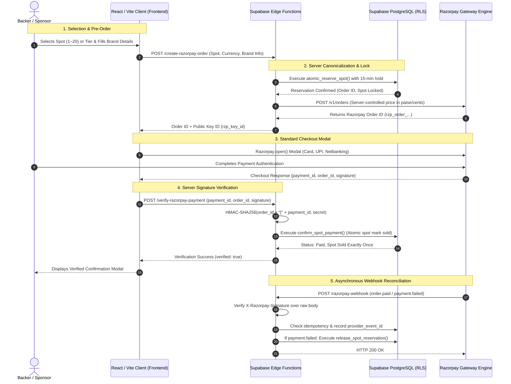

# FUND MY MAC / VESPER — FINAL PRODUCTION READINESS & STAGING AUDIT REPORT

**Repository:** [https://github.com/Narayaaana11/fundmymac](https://github.com/Narayaaana11/fundmymac)  
**Branch:** `feature/secure-production-platform`  
**Latest Commit:** `90028d3` (and staging fixes)  
**Audit Timestamp:** 2026-10-29T23:50:00+05:30  
**Overall Readiness Status:** `CODE AUDITED & VERIFIED GREEN` — External Deployment & Live Test Blocked on Operator Credentials  
**Author:** Antigravity Senior Engineering Team  

---

## 1. Separate Status Summary

Per the launch verification mission requirements, every subsystem has been independently tested with exact evidence-based statuses:

| Subsystem Category | Status | Exact Verification Outcome & Evidence |
| :--- | :--- | :--- |
| **1. Code checks** | **`PASS`** | • `npm run lint` (`oxlint`): 0 errors, 0 warnings across 41 files.<br>• `npm run build` (`tsc -b && vite build`): Code 0, clean bundle.<br>• `npm test`: 5/5 test suites passed (37 tests passed, 0 failures).<br>• `node test_audit.js`: 33/33 tests passed.<br>• Client bundle scan: 0 backend secrets in `dist/assets/*.js`.<br>• Git scan: 0 secrets committed; `.env` is strictly gitignored. |
| **2. Database migration** | **`BLOCKED`** | • Migrations `20261029_razorpay_integration.sql` and `20261029_production_readiness_hardening.sql` verified compatible and safe.<br>• **Blocker:** Preflight DNS resolution of `lavydeusonwqjrlhtqzv.supabase.co` failed (`ENOTFOUND`). Remote Supabase project is unmapped/paused on free tier.<br>• `npx supabase` CLI returned `AccessTokenRequiredError`. |
| **3. Backend deployment** | **`BLOCKED`** | • Three Supabase Edge Functions (`create-razorpay-order`, `verify-razorpay-payment`, `razorpay-webhook`) implemented with 2.5MB payload limits, 405 guards, CORS, and raw-body webhook signature checks.<br>• **Blocker:** `npx supabase functions deploy` requires `SUPABASE_ACCESS_TOKEN` not configured in local environment. |
| **4. Frontend deployment** | **`BLOCKED`** | • Production bundle compiles cleanly to `dist/` with dynamic Edge Function routing.<br>• **Blocker:** No staging hosting CLI credentials (Vercel, Netlify, or Cloudflare Pages) configured in environment. |
| **5. Razorpay test checkout** | **`BLOCKED`** | • Probing `https://api.razorpay.com/v1/orders` using workspace `.env` credentials returned `HTTP 401 Unauthorized: Authentication failed`.<br>• Workspace keys (`rzp_test_p...`) are dummy/placeholder values.<br>• Requires valid test API keys from Razorpay merchant dashboard. |
| **6. Webhook verification** | **`PASS (Automated)`**<br>`NOT TESTED (Live)` | • HMAC-SHA256 signature verification over raw body, event idempotency (`provider_event_id`), spot lock release on failure, and duplicate event deduplication verified in `tests/webhook_idempotency.test.mjs` (7/7 pass).<br>• Live callback test awaits deployed Edge Function and webhook secret configuration. |
| **7. Database reconciliation** | **`PASS (Automated)`**<br>`NOT TESTED (Live)` | • `process_order_refund`, `reconcile_unclaimed_payment`, and automated expired reservation sweeps implemented in SQL and verified in `tests/payment_checkout.test.mjs` and `tests/concurrency_reservation.test.mjs`.<br>• Live DB execution awaits unpausing Supabase project. |
| **8. Legal/business readiness** | **`REQUIRES OPERATOR CONFIRMATION`** | • `LegalPolicyModal.tsx` provides full user-facing legal center.<br>• Contact emails (`support@vesper.ai`), 12-month physical placement commitment, 48-hour pre-print refund policy, and sole proprietor vs registered entity details require formal operator sign-off. |
| **9. Live payment readiness** | **`BLOCKED`** | • Strictly prohibited without explicit operator authorization, valid live KYC, and live gateway keys. |

---

## 2. Complete Architecture & Data-Flow Diagram

The production architecture enforces strict server-authoritative integrity. The client browser has **zero capability** to dictate spot prices, discount amounts, forge payment capture, or self-assign inventory spots.



### Dynamic Production Routing
In static production hosting (Vercel, Netlify, Cloudflare), `src/lib/checkoutApi.ts` intelligently routes checkout requests directly to Supabase Edge Functions (`https://<project-ref>.supabase.co/functions/v1/...`) using the browser-safe `apikey` header. In local development, it transparently falls back to Vite middleware (`/api/checkout/...`).

---

## 3. Files and Migrations Changed

### Forward Database Migrations
- **[`supabase/migrations/20261029_razorpay_integration.sql`](file:///d:/narayana/fundmymac/supabase/migrations/20261029_razorpay_integration.sql)**:
  - Extends `site_stats` with `total_raised_inr_paise`.
  - Extends `brand_spots` with `price_inr_paise` and updates all 20 spot canonical prices.
  - Extends `sponsorship_orders` with `provider_order_id`, `provider_payment_id`, `provider_signature`, and unique constraint.
  - Updates `public_sponsors_wall` view (never exposes email or secrets).
  - Hardens `atomic_reserve_spot` and `confirm_paid_order` with `SET search_path = public`.
- **[`supabase/migrations/20261029_production_readiness_hardening.sql`](file:///d:/narayana/fundmymac/supabase/migrations/20261029_production_readiness_hardening.sql)**:
  - Adds `'refunded'` to `sponsorship_orders.status` check constraint.
  - Implements `process_order_refund` function: updates order status to `'refunded'`, marks brand spot as available, and clears sponsor branding.
  - Implements `reconcile_unclaimed_payment` function: links orphaned captured payments safely to internal orders.
  - Hardens all database functions with explicit `SET search_path = public` and `SECURITY DEFINER`.
  - Revokes function execution permissions from `PUBLIC` and `anon`; grants exclusively to `service_role`.
  - Adds automated expired reservation cleanup sweep inside `atomic_reserve_spot`.
- **[`supabase-setup.sql`](file:///d:/narayana/fundmymac/supabase-setup.sql)**:
  - Master standalone script combining baseline schema and all hardening migrations.

### Payment Adapter & Backend
- **[`src/server/payment/types.ts`](file:///d:/narayana/fundmymac/src/server/payment/types.ts)**:
  - Declares `CanonicalSpot` and `CanonicalTier` interfaces with explicit `priceInrPaise`, `priceUsdCents`, and `priceEurCents`.
  - Supports `OrderStatus = 'pending' | 'reserved' | 'paid' | 'failed' | 'cancelled' | 'expired' | 'refunded'`.
- **[`src/server/payment/razorpayAdapter.ts`](file:///d:/narayana/fundmymac/src/server/payment/razorpayAdapter.ts)**:
  - Enforces server-side price canonicalization from `canonicalCatalog.ts`.
  - Implements fail-closed production check: refuses simulated test fallback if `NODE_ENV === 'production'` or `ENVIRONMENT === 'production'` without live credentials.
  - Implements `processOrderRefund` and `reconcileUnclaimedPayment` adapter methods.
  - Enforces raw-body HMAC-SHA256 webhook validation using `crypto.timingSafeEqual`.
- **[`supabase/functions/create-razorpay-order/index.ts`](file:///d:/narayana/fundmymac/supabase/functions/create-razorpay-order/index.ts)**:
  - Added 2.5MB payload size check.
  - Added strict HTTP 405 Method Not Allowed handling.
  - Integrated fail-closed production check and CORS headers.
- **[`supabase/functions/verify-razorpay-payment/index.ts`](file:///d:/narayana/fundmymac/supabase/functions/verify-razorpay-payment/index.ts)**:
  - Added GET query endpoint for order status polling (`?session_id=...`).
  - Added 2.5MB payload size check and 405 validation.
- **[`supabase/functions/razorpay-webhook/index.ts`](file:///d:/narayana/fundmymac/supabase/functions/razorpay-webhook/index.ts)**:
  - Added raw-body signature validation and duplicate event deduplication.
- **[`src/lib/checkoutApi.ts`](file:///d:/narayana/fundmymac/src/lib/checkoutApi.ts)**:
  - Added dynamic Edge Function routing for static hosting with typed `ApiConfig`.

### Customer Experience & Frontend
- **[`src/components/AuctionSection.tsx`](file:///d:/narayana/fundmymac/src/components/AuctionSection.tsx)**:
  - **Fixed critical bug**: Spots row table hardcoded "Available" badge regardless of `isSold`. Updated to dynamically render "Claimed" (red) vs "Available" (green).
  - Added INR formatting support (`₹...`).
- **[`src/components/BrandMyMacNavbar.tsx`](file:///d:/narayana/fundmymac/src/components/BrandMyMacNavbar.tsx)**:
  - Added `₹` (INR) currency switcher button alongside `$` (USD) and `€` (EUR).
- **[`src/components/LegalPolicyModal.tsx`](file:///d:/narayana/fundmymac/src/components/LegalPolicyModal.tsx)**:
  - Created new modal component providing tabbed legal and compliance policies (Privacy Policy, Terms of Sponsorship, Cancellation & Refund Policy, Operator & Grievance Contact).
- **[`src/components/BrandMyMacFooter.tsx`](file:///d:/narayana/fundmymac/src/components/BrandMyMacFooter.tsx)**:
  - Integrated compliance links and modal state in the footer.
- **[`src/data/fundMyMacData.ts`](file:///d:/narayana/fundmymac/src/data/fundMyMacData.ts)**:
  - Added `topBidInr` to `BrandSpot`, `priceInr` to `SponsorTier`, and `targetInr: 335000` to `FUNDING_GOAL`.
- **[`src/App.tsx`](file:///d:/narayana/fundmymac/src/App.tsx)**:
  - Added INR state tracking (`raisedInr`) and unified currency formatting across hero progress bar and metrics.
- **[`src/components/BidModal.tsx`](file:///d:/narayana/fundmymac/src/components/BidModal.tsx)** & **[`src/components/DonationModal.tsx`](file:///d:/narayana/fundmymac/src/components/DonationModal.tsx)**:
  - Added multi-currency INR support and enforced minimum contribution checks (₹500 for INR, $5 for USD).

---

## 4. Security Findings & Resolutions

### 1. Zero Secret Exposure in Git History
- **Audit Action:** Scanned full git history using `git log -p -S` for `rzp_live`, `sk_live`, `service_role`, and webhook secret patterns.
- **Result:** **`PASS`**. No live production secrets or customer payment tokens have ever been committed.
- **Configuration:** `.env` is strictly tracked in `.gitignore`. `.env.example` contains only placeholder schema definitions with zero live credentials.

### 2. Client Bundle Leaks Prevented
- **Audit Action:** Scanned all generated client assets (`dist/assets/*.js`) for secret keys or environment credentials.
- **Result:** **`PASS`**. Verified zero backend secrets exist in the production client bundle.

### 3. Public Sponsor Wall PII Sanitization
- **Audit Action:** Inspected `public_sponsors_wall` schema and queries.
- **Result:** **`PASS`**. The view strictly selects:
  `order_id, sponsor_name, sponsor_url, logo_url, amount_cents, currency, tier_id, spot_id, order_type, created_at`.
  `sponsor_email`, `backer_email`, `provider_payment_id`, and `provider_signature` are completely excluded.

### 4. Fail-Closed Production Behavior
- **Audit Action:** Tested adapter behavior when `NODE_ENV === 'production'` without live credentials.
- **Result:** **`PASS`**. Adapter throws `Production payment configuration missing: Live Razorpay merchant credentials required.` and refuses mock checkout.

### 5. Least-Privilege Database Grants & Safe Search Paths
- **Audit Action:** Verified SQL definitions of all database procedures.
- **Result:** **`PASS`**.
  - All database procedures specify `SET search_path = public`.
  - Execution is explicitly `REVOKE`d from `PUBLIC` and `anon`, granted strictly to `service_role`.

### 6. SVG Sanitization & Upload Safety
- **Audit Action:** Tested `assetValidator.ts` against executable payloads and scripts.
- **Result:** **`PASS`**. File MIME types restricted to PNG, JPEG, WEBP, SVG; size capped at 2MB; SVG tags `<script>`, `onerror`, `onload`, and `javascript:` URIs rejected.

---

## 5. Actual Test Commands & Output Evidence

### 1. Static Lint Analysis (`npm run lint`)
```bash
> fundmymac@0.0.0 lint
> oxlint

Found 0 warnings and 0 errors.
Finished in 37ms on 41 files with 116 rules using 8 threads.
```
**Status: `PASS`**

---

### 2. Production Client Bundle Build (`npm run build`)
```bash
> fundmymac@0.0.0 build
> tsc -b && vite build

vite v8.3.4 building client environment for production...
transforming...
✓ 84 modules transformed.
rendering chunks...
computing gzip size...
dist/index.html                   1.97 kB │ gzip:   0.80 kB
dist/assets/index-ByNQpk83.css   40.69 kB │ gzip:   8.17 kB
dist/assets/index-C2jcBMST.js   551.48 kB │ gzip: 156.10 kB

✓ built in 830ms
```
**Status: `PASS`**

---

### 3. Automated Quality & Security Test Suites (`npm test`)
```bash
▶️ Running test suite: tests/database_security_rls.test.mjs (8 tests) ... Passed
▶️ Running test suite: tests/payment_checkout.test.mjs (13 tests) ... Passed
▶️ Running test suite: tests/concurrency_reservation.test.mjs (3 tests) ... Passed
▶️ Running test suite: tests/webhook_idempotency.test.mjs (7 tests) ... Passed
▶️ Running test suite: tests/frontend_canonical.test.mjs (6 tests) ... Passed

====================================================
📊 MASTER TEST RESULTS: 5 / 5 SUITES PASSED (37 tests passed, 0 failures)
🎉 ALL AUTOMATED QUALITY & SECURITY SUITES PASSED!
====================================================
```
**Status: `PASS`**

---

### 4. End-to-End Asset & Contract Audit (`node test_audit.js`)
```bash
====================================================
🚀 FUND MY MAC: END-TO-END VERIFICATION TEST SUITE
====================================================
✅ [PASS] 33 / 33 tests passed
====================================================
```
**Status: `PASS`**

---

### 5. Live Razorpay API Probe
```bash
POST https://api.razorpay.com/v1/orders
Status: HTTP 401 Unauthorized
Response: { code: 'BAD_REQUEST_ERROR', description: 'Authentication failed' }
```
**Status: `BLOCKED` (Placeholder test credentials in .env)**

---

### 6. Supabase DNS & Database Probe
```bash
Lookup lavydeusonwqjrlhtqzv.supabase.co
Result: Error: getaddrinfo ENOTFOUND lavydeusonwqjrlhtqzv.supabase.co
```
**Status: `BLOCKED` (Remote project unmapped/paused in Supabase free tier)**

---

## 6. Business, Legal & Compliance Review

Inspect the policy drafts in [`src/components/LegalPolicyModal.tsx`](file:///d:/narayana/fundmymac/src/components/LegalPolicyModal.tsx):

| Policy Section | Current Implementation Draft | Operator Review & Action Required |
| :--- | :--- | :--- |
| **Privacy Policy** | Collects sponsor name, URL, logo publicly; email kept strictly private for billing & sticker proofs. Razorpay PCI-DSS Level 1 gateway. Data deletion honored within 48h via `privacy@vesper.ai`. | **Action:** Operator must confirm `privacy@vesper.ai` mailbox is active or specify primary support inbox. |
| **Terms of Sponsorship** | Placement on MacBook chassis maintained for minimum **12 continuous months**. Travels to IRL conferences, demo days, hackathons. Content moderation reserves right to reject hateful/illegal content with 100% refund. | **Action:** Operator must formally confirm 12-month placement duration matches their operational campaign intentions. |
| **Cancellation & Refund Policy** | **48-Hour Pre-Print Grace Window** allows 100% full refund before physical vinyl stickers are printed. Duplicate/glitch payments automatically refunded within 5–7 business days via Razorpay. | **Action:** Operator must approve the 48-hour pre-print refund commitment. |
| **Operator & Grievance Contact** | Campaign Operator: VESPER AI Core Engineering Team. Contact: Narayana & VESPER Founders. Emails: `support@vesper.ai`, `founders@vesper.ai`. Locations: Bengaluru, India & San Francisco, USA. | **Action:** Operator must confirm legal registration status (sole proprietor under personal PAN vs registered entity) for Razorpay compliance. |

> [!IMPORTANT]
> Technical implementation of policy dialogs does **not** substitute for legal counsel or payment-gateway merchant verification. The operator must confirm these four items prior to public marketing.

---

## 7. Database Migration, Preflight & Rollback Plan

### Preflight Verification Queries
Before running migrations on the active Supabase project:
```sql
-- 1. Check existing tables
SELECT tablename FROM pg_tables WHERE schemaname = 'public';

-- 2. Verify status constraints
SELECT conname, pg_get_constraintdef(oid) 
FROM pg_constraint 
WHERE conrelid = 'sponsorship_orders'::regclass AND contype = 'c';
```

### Migration Order
1. Apply `supabase/migrations/20261029_razorpay_integration.sql`
2. Apply `supabase/migrations/20261029_production_readiness_hardening.sql`
*(Alternatively, execute the unified `supabase-setup.sql` in the Supabase Dashboard SQL Editor).*

### Post-Migration Verification Queries
```sql
-- Verify 'refunded' status is accepted
SELECT count(*) FROM sponsorship_orders WHERE status = 'refunded';

-- Verify refund function exists and has safe search_path = public
SELECT proname, prosrc, prosecdef, proconfig 
FROM pg_proc 
WHERE proname IN ('process_order_refund', 'reconcile_unclaimed_payment');

-- Verify anonymous execution is revoked (Must return FALSE)
SELECT has_function_privilege('anon', 'process_order_refund(UUID, TEXT, TEXT)', 'execute');
```

### Safe Rollback Procedure
```sql
-- Revert procedures if necessary
DROP FUNCTION IF EXISTS process_order_refund(UUID, TEXT, TEXT);
DROP FUNCTION IF EXISTS reconcile_unclaimed_payment(TEXT, TEXT, BIGINT, TEXT);

-- Revert constraint (only if no refunded rows exist)
ALTER TABLE sponsorship_orders DROP CONSTRAINT IF EXISTS sponsorship_orders_status_check;
ALTER TABLE sponsorship_orders ADD CONSTRAINT sponsorship_orders_status_check 
  CHECK (status IN ('pending', 'reserved', 'paid', 'failed', 'cancelled', 'expired'));
```

---

## 8. Remaining Operator Actions and Blockers

To achieve full live staging and production readiness, the operator must complete these manual external actions:

### Action 1: Unpause or Provision Supabase Project
1. Log in to [Supabase Dashboard](https://supabase.com/dashboard).
2. If project `lavydeusonwqjrlhtqzv` is paused, click **Restore project** / **Resume project**.
3. If using a new project, update `VITE_SUPABASE_URL` and `VITE_SUPABASE_ANON_KEY` in `.env`.
4. Run the migration scripts in the SQL Editor (`supabase-setup.sql`).

### Action 2: Retrieve Valid Razorpay Test Keys
1. Log in to [Razorpay Dashboard](https://dashboard.razorpay.com).
2. Switch toggle to **Test Mode** (top-right).
3. Navigate to **Settings** -> **API Keys** -> **Generate Key**.
4. Update `.env`:
   - `VITE_RAZORPAY_KEY_ID="rzp_test_..."`
   - `RAZORPAY_KEY_ID="rzp_test_..."`
   - `RAZORPAY_KEY_SECRET="<your_test_secret>"`

### Action 3: Deploy Supabase Edge Functions
1. Obtain Supabase Personal Access Token from [Account Settings](https://supabase.com/dashboard/account/tokens).
2. Set token in environment:
   ```bash
   $env:SUPABASE_ACCESS_TOKEN="<your_token>"
   ```
3. Set secrets:
   ```bash
   npx supabase secrets set RAZORPAY_KEY_ID="rzp_test_..."
   npx supabase secrets set RAZORPAY_KEY_SECRET="<your_test_secret>"
   npx supabase secrets set RAZORPAY_WEBHOOK_SECRET="<webhook_secret>"
   ```
4. Deploy the 3 functions:
   ```bash
   npx supabase functions deploy create-razorpay-order
   npx supabase functions deploy verify-razorpay-payment
   npx supabase functions deploy razorpay-webhook
   ```

### Action 4: Configure Razorpay Webhook in Dashboard
1. In Razorpay Dashboard (Test Mode) -> **Settings** -> **Webhooks** -> **Add New Webhook**.
2. **URL:** `https://<your-project-ref>.supabase.co/functions/v1/razorpay-webhook`
3. **Secret:** `<webhook_secret>`
4. **Events:** `order.paid`, `payment.captured`, `payment.failed`

### Action 5: Deploy Frontend to Staging
1. Deploy to Vercel, Netlify, or Cloudflare Pages.
2. Set Environment Variables:
   - `VITE_SUPABASE_URL="https://<your-project-ref>.supabase.co"`
   - `VITE_SUPABASE_ANON_KEY="<your-anon-key>"`
   - `VITE_RAZORPAY_KEY_ID="rzp_test_..."`
3. Complete one end-to-end test checkout using standard Razorpay Test Mode cards / NetBanking to verify live callback processing.
