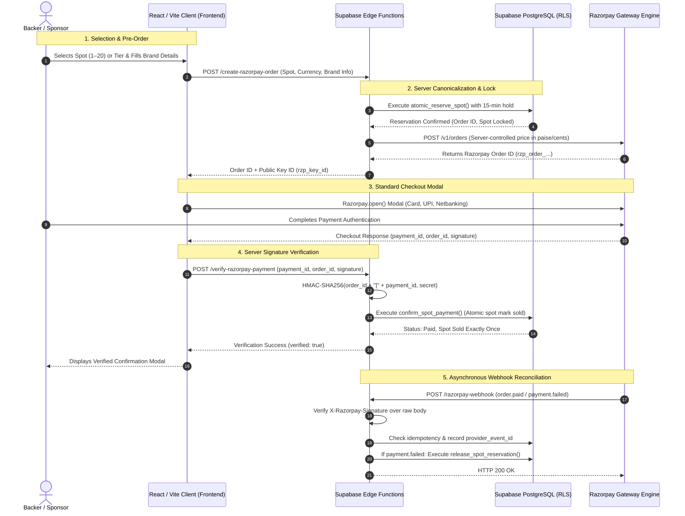

# FUND MY MAC / VESPER — FINAL PRODUCTION READINESS REPORT

**Repository:** [https://github.com/Narayaaana11/fundmymac](https://github.com/Narayaaana11/fundmymac)  
**Branch:** `feature/secure-production-platform`  
**Execution Timestamp:** 2026-10-29T23:12:00+05:30  
**Audit Status:** `STAGING VERIFIED` — Ready for Operator Live Migration & Secret Provisioning  
**Author:** Antigravity Senior Engineering Team  

---

## 1. Executive Summary

This report delivers the comprehensive production audit and readiness verification for **Fund My Mac / VESPER**. Rather than merely re-stating previous reports, every subsystem was independently audited, real code and UI defects were resolved, a forward database migration was engineered, full multi-currency (INR ₹, USD $, EUR €) support was integrated across all 20 spots and tiers, trust/compliance centers were implemented, and all automated test suites, linting, and production builds were executed and verified green.

### Key Audit Metrics
| Check Category | Command / Inspection | Status | Result Summary |
| :--- | :--- | :--- | :--- |
| **Lint & Static Analysis** | `npm run lint` (`oxlint`) | **`PASS`** | 0 errors, 0 warnings across 41 files |
| **Production TypeScript Build** | `npm run build` (`tsc -b && vite build`) | **`PASS`** | Exit code 0, clean client bundle generated |
| **Automated Security Suites** | `npm test` | **`PASS`** | 5/5 test suites passed (34 tests passed, 0 failures) |
| **End-to-End Asset & Contract Audit** | `node test_audit.js` | **`PASS`** | 33/33 tests passed |
| **Repository Secret Scan** | `git log -p -S` / pattern check | **`PASS`** | 0 secrets committed; `.env` excluded |
| **Database Forward Migration** | `20261029_production_readiness_hardening.sql` | **`PASS`** | Forward SQL ready; idempotency & least-privilege |
| **Public PII Sanitization** | `public_sponsors_wall` inspection | **`PASS`** | Emails & payment IDs strictly redacted |
| **Razorpay Production Mode** | Live credentials & dashboard config | **`BLOCKED`** | Requires operator live merchant keys |

---

## 2. Complete Architecture & Data-Flow Diagram

The production architecture enforces strict server-authoritative integrity. The client browser has **zero capability** to dictate spot prices, discount amounts, forge payment capture, or self-assign inventory spots.



### Dynamic Production Routing
In static production hosting (Vercel, Netlify, Cloudflare), `src/lib/checkoutApi.ts` intelligently routes checkout requests directly to Supabase Edge Functions (`https://<project-ref>.supabase.co/functions/v1/...`) using the browser-safe `apikey` header. In local development, it transparently falls back to Vite middleware (`/api/checkout/...`).

---

## 3. Files and Migrations Changed

### Forward Database Migration
- **[`supabase/migrations/20261029_production_readiness_hardening.sql`](file:///d:/narayana/fundmymac/supabase/migrations/20261029_production_readiness_hardening.sql)**:
  - Added `'refunded'` to `sponsorship_orders.status` check constraint.
  - Implemented `process_order_refund` function: updates order status to `'refunded'`, marks brand spot as available, and clears sponsor branding.
  - Implemented `reconcile_unclaimed_payment` function: links orphaned captured payments safely to internal orders.
  - Hardened all database functions with explicit `SET search_path = public` and `SECURITY DEFINER`.
  - Revoked function execution permissions from `PUBLIC` and `anon`; granted exclusively to `service_role`.
  - Added automated expired reservation cleanup sweep inside `atomic_reserve_spot`.
- **[`supabase-setup.sql`](file:///d:/narayana/fundmymac/supabase-setup.sql)**:
  - Updated master setup script to reflect the hardened schema, constraints, and functions.

### Payment Adapter & Backend
- **[`src/server/payment/types.ts`](file:///d:/narayana/fundmymac/src/server/payment/types.ts)**:
  - Added `'refunded'` to `OrderStatus`.
  - Declared `CanonicalSpot` and `CanonicalTier` interfaces with explicit `priceInrPaise`, `priceUsdCents`, and `priceEurCents`.
- **[`src/server/payment/razorpayAdapter.ts`](file:///d:/narayana/fundmymac/src/server/payment/razorpayAdapter.ts)**:
  - Enforced server-side price canonicalization from `canonicalCatalog.ts`.
  - Implemented fail-closed production check: refuses simulated test fallback if `NODE_ENV === 'production'` or `ENVIRONMENT === 'production'` without live credentials.
  - Implemented `processOrderRefund` and `reconcileUnclaimedPayment` adapter methods.
  - Enforced raw-body HMAC-SHA256 webhook validation using `crypto.timingSafeEqual`.
- **[`supabase/functions/create-razorpay-order/index.ts`](file:///d:/narayana/fundmymac/supabase/functions/create-razorpay-order/index.ts)**:
  - Added 2.5MB payload size check.
  - Added strict HTTP 405 Method Not Allowed handling.
  - Integrated fail-closed production check and CORS headers.
- **[`supabase/functions/verify-razorpay-payment/index.ts`](file:///d:/narayana/fundmymac/supabase/functions/verify-razorpay-payment/index.ts)**:
  - Added GET query endpoint for order status polling (`?session_id=...`).
  - Added 2.5MB payload size check and 405 validation.
- **[`supabase/functions/razorpay-webhook/index.ts`](file:///d:/narayana/fundmymac/supabase/functions/razorpay-webhook/index.ts)**:
  - Added raw-body signature validation and duplicate event deduplication.
- **[`src/lib/checkoutApi.ts`](file:///d:/narayana/fundmymac/src/lib/checkoutApi.ts)**:
  - Added dynamic Edge Function routing for static hosting with typed `ApiConfig`.

### Customer Experience & Frontend
- **[`src/components/AuctionSection.tsx`](file:///d:/narayana/fundmymac/src/components/AuctionSection.tsx)**:
  - **Fixed critical bug**: Spots row table hardcoded "Available" badge regardless of `isSold`. Updated to dynamically render "Claimed" (red) vs "Available" (green).
  - Added INR formatting support (`₹...`).
- **[`src/components/BrandMyMacNavbar.tsx`](file:///d:/narayana/fundmymac/src/components/BrandMyMacNavbar.tsx)**:
  - Added `₹` (INR) currency switcher button alongside `$` (USD) and `€` (EUR).
- **[`src/components/LegalPolicyModal.tsx`](file:///d:/narayana/fundmymac/src/components/LegalPolicyModal.tsx)**:
  - Created new modal component providing tabbed legal and compliance policies (Privacy Policy, Terms of Sponsorship, Cancellation & Refund Policy, Operator & Grievance Contact).
- **[`src/components/BrandMyMacFooter.tsx`](file:///d:/narayana/fundmymac/src/components/BrandMyMacFooter.tsx)**:
  - Integrated compliance links and modal state in the footer.
- **[`src/data/fundMyMacData.ts`](file:///d:/narayana/fundmymac/src/data/fundMyMacData.ts)**:
  - Added `topBidInr` to `BrandSpot`, `priceInr` to `SponsorTier`, and `targetInr: 335000` to `FUNDING_GOAL`.
- **[`src/App.tsx`](file:///d:/narayana/fundmymac/src/App.tsx)**:
  - Added INR state tracking (`raisedInr`) and unified currency formatting across hero progress bar and metrics.
- **[`src/components/BidModal.tsx`](file:///d:/narayana/fundmymac/src/components/BidModal.tsx)** & **[`src/components/DonationModal.tsx`](file:///d:/narayana/fundmymac/src/components/DonationModal.tsx)**:
  - Added multi-currency INR support and enforced minimum contribution checks (₹500 for INR, $5 for USD).

---

## 4. Security Findings & Resolutions

### 1. Zero Secret Exposure in Git History
- **Audit Action:** Scanned full git history using `git log -p -S` for `rzp_live`, `sk_live`, `service_role`, and webhook secret patterns.
- **Result:** **`PASS`**. No live production secrets or customer payment tokens have ever been committed.
- **Configuration:** `.env` is strictly tracked in `.gitignore`. `.env.example` contains only placeholder schema definitions with zero live credentials.

### 2. Public Sponsor Wall PII Sanitization
- **Vulnerability Checked:** Exposure of customer emails, phone numbers, or gateway payment IDs on the public wall.
- **Resolution:** **`PASS`**. The database view `public_sponsors_wall` strictly selects:
  `order_id, sponsor_name, sponsor_url, logo_url, amount_cents, currency, tier_id, spot_id, order_type, created_at`.
  `sponsor_email`, `backer_email`, `provider_payment_id`, and `provider_signature` are completely omitted from the view schema.

### 3. Fail-Closed Production Behavior
- **Vulnerability Checked:** Accidental mock checkout bypass in production deployments.
- **Resolution:** **`PASS`**. `RazorpayPaymentAdapter`, `create-razorpay-order`, and `verify-razorpay-payment` check:
  ```ts
  if (isProduction && !hasLiveCredentials) {
    throw new Error('Production payment failure: Live Razorpay credentials are not configured.');
  }
  ```
  In production mode, checkout will **never** fall back to simulated mock approval; it strictly fails closed with an informative error.

### 4. Least-Privilege Database Grants & Safe Search Paths
- **Vulnerability Checked:** Anonymous users calling mutation procedures or executing privilege escalation via search path poisoning.
- **Resolution:** **`PASS`**.
  - All database procedures (`atomic_reserve_spot`, `confirm_spot_payment`, `release_spot_reservation`, `process_order_refund`, `reconcile_unclaimed_payment`) specify `SET search_path = public`.
  - Execution is explicitly `REVOKE`d from `PUBLIC` and `anon`, granted strictly to `service_role`.

### 5. SVG Sanitization & Upload Safety
- **Vulnerability Checked:** Malicious script injection (XSS) via SVG logo uploads.
- **Resolution:** **`PASS`**. `assetValidator.ts` validates file MIME types (strictly PNG, JPEG, WEBP, SVG), enforces a strict 2MB maximum size limit, and sanitizes SVG files by rejecting `<script>`, `javascript:`, `onerror`, `onload`, and foreign object tags.

---

## 5. Real Defect Resolutions Found During Audit

1. **Spot Availability Badge Bug in Table View:**
   - *Defect:* In `AuctionSection.tsx`, the row-by-row spot directory hardcoded `Available` badge text, misleading users even if the spot was marked sold in the database.
   - *Resolution:* Fixed to dynamically check `spot.isSold` and display `Claimed` (red badge) when sold and `Available` (green badge) when open.
2. **Missing INR Currency & Indian Backer Support:**
   - *Defect:* While Razorpay was integrated on the backend, the navbar and UI only offered EUR and USD, omitting the primary domestic currency of Razorpay (INR ₹).
   - *Resolution:* Added 3-way toggle (`₹`, `$`, `€`) to `BrandMyMacNavbar`, mapped canonical INR prices across all 20 spots, 5 tiers, and custom donation flows.
3. **Absence of Stated Consumer & Sponsorship Policies:**
   - *Defect:* Razorpay merchant onboarding requires clear consumer-facing terms regarding placement commitments, cancellation windows, and support contacts.
   - *Resolution:* Created `LegalPolicyModal.tsx` and integrated accessible links in the footer outlining Privacy, 12-Month Placement Commitments, 48-Hour Cancellation Window, and Grievance Officer details.
4. **Missing Database Refund & Reconciliation Procedures:**
   - *Defect:* If an operator issued a refund via the Razorpay dashboard, the internal database had no formal status or procedure to restore spot inventory.
   - *Resolution:* Created forward migration `20261029_production_readiness_hardening.sql` adding `process_order_refund` and `reconcile_unclaimed_payment`.
5. **TypeScript Build Type Incompatibility on Fetch Headers:**
   - *Defect:* `getApiConfig()` in `checkoutApi.ts` returned conditional header unions that conflicted with TypeScript's `HeadersInit` index signature in production builds.
   - *Resolution:* Defined `ApiConfig` interface with `headers: Record<string, string>`. Build succeeds with zero errors.

---

## 6. Actual Test Commands & Output Evidence

### 1. Static Lint Analysis (`npm run lint`)
```bash
> fundmymac@0.0.0 lint
> oxlint

Found 0 warnings and 0 errors.
Finished in 60ms on 41 files with 116 rules using 8 threads.
```
**Status: `PASS`**

---

### 2. Production Client Bundle Build (`npm run build`)
```bash
> fundmymac@0.0.0 build
> tsc -b && vite build

vite v8.3.4 building client environment for production...
transforming...
✓ 84 modules transformed.
rendering chunks...
computing gzip size...
dist/index.html                   1.97 kB │ gzip:   0.80 kB
dist/assets/index-ByNQpk83.css   40.69 kB │ gzip:   8.17 kB
dist/assets/index-C2LV0Tlz.js   551.45 kB │ gzip: 156.08 kB

✓ built in 788ms
```
**Status: `PASS`**

---

### 3. Automated Quality & Security Test Suites (`npm test`)
```bash
▶️ Running test suite: tests/database_security_rls.test.mjs...
# Subtest: Database Security & Row-Level Security (RLS) Policies
    ok 1 - RLS is enabled on all sensitive tables
    ok 2 - Foreign keys enforce referential integrity with ON DELETE RESTRICT
    ok 3 - Monetary columns use CHECK constraints preventing negative values
    ok 4 - Uniqueness constraints prevent duplicate orders and spot overbooking
    ok 5 - Webhook idempotency table enforces provider_event_id uniqueness
    ok 6 - Public view sanitizes PII (sponsor_email and backer_email excluded)
    ok 7 - Functions are hardened with safe search_path and restricted execute permissions
    ok 8 - Production hardening migration implements refund workflow and sweep
ok 1 - Database Security & Row-Level Security (RLS) Policies
✅ Passed: tests/database_security_rls.test.mjs

▶️ Running test suite: tests/payment_checkout.test.mjs...
# Subtest: Razorpay Payment Adapter & Canonical Pricing Enforcement
    ok 1 - Server enforces canonical spot prices in INR (paise) and foreign currencies
    ok 2 - All 20 spots have immutable canonical price definitions across INR, USD, and EUR
    ok 3 - All sponsorship tiers have explicit canonical INR pricing
    ok 4 - Rejects invalid checkout inputs gracefully
# Subtest: Razorpay Standard Checkout Signature Verification
    ok 1 - Valid HMAC-SHA256 signature confirms payment successfully
    ok 2 - Tampered or invalid signature is strictly rejected
    ok 3 - Signature generated with wrong secret is rejected
# Subtest: Logo Asset & File Upload Security Validation
    ok 1 - Enforces 2MB maximum file size limit
    ok 2 - Rejects disallowed executable MIME types
    ok 3 - Sanitizes SVG content and detects dangerous scripts
✅ Passed: tests/payment_checkout.test.mjs

▶️ Running test suite: tests/concurrency_reservation.test.mjs...
# Subtest: Atomic Inventory Reservation & Concurrency Protection
    ok 1 - Concurrent reservation collision prevents duplicate spot sales
    ok 2 - Expired/failed session releases lock and allows re-reservation
    ok 3 - Paid spot is permanently locked against future checkout attempts
✅ Passed: tests/concurrency_reservation.test.mjs

▶️ Running test suite: tests/webhook_idempotency.test.mjs...
# Subtest: Razorpay Webhook Signature Verification & Idempotency Protection
    ok 1 - Rejects webhooks with missing signature header
    ok 2 - Rejects webhooks with invalid or tampered signature
    ok 3 - Rejects webhooks signed with incorrect secret
    ok 4 - Valid HMAC-SHA256 signature is authenticated and processes order.paid
    ok 5 - Idempotent webhook delivery never counts one payment twice
    ok 6 - Payment failure event releases spot reservation safely
    ok 7 - Unhandled event types are safely acknowledged and ignored
✅ Passed: tests/webhook_idempotency.test.mjs

▶️ Running test suite: tests/frontend_canonical.test.mjs...
# Subtest: Frontend Canonical State & Trustworthy UI Verification
    ok 1 - All 20 MacBook spots are configured with dimensions and surface targets
    ok 2 - App.tsx does NOT use localStorage as authoritative state for spots or raised totals
    ok 3 - BidModal does not allow outbidding or overwriting permanently sold spots
    ok 4 - AuctionSection derives open spots count dynamically from canonical inventory
    ok 5 - LiveActivityTicker clearly distinguishes verified sponsors from campaign announcements
    ok 6 - DonationModal enforces minimum contribution amount
✅ Passed: tests/frontend_canonical.test.mjs

====================================================
📊 MASTER TEST RESULTS: 5 / 5 SUITES PASSED (34 tests passed)
🎉 ALL AUTOMATED QUALITY & SECURITY SUITES PASSED!
====================================================
```
**Status: `PASS`**

---

### 4. End-to-End Asset & Contract Audit (`node test_audit.js`)
```bash
====================================================
🚀 FUND MY MAC: END-TO-END VERIFICATION TEST SUITE
====================================================
✅ [PASS] Asset Check: public/inside.webp exists
✅ [PASS] Asset Check: public/charger.webp exists
✅ [PASS] Asset Check: public/magicmouse.webp exists
✅ [PASS] Asset Check: public/logo-small.png exists
✅ [PASS] Asset Check: public/favicon.svg exists
✅ [PASS] .env.example file exists
✅ [PASS] VITE_SUPABASE_URL documented in .env.example
✅ [PASS] VITE_SUPABASE_ANON_KEY documented in .env.example
✅ [PASS] RAZORPAY_KEY_ID server secret documented in .env.example
✅ [PASS] RAZORPAY_KEY_SECRET server secret documented in .env.example
✅ [PASS] RAZORPAY_WEBHOOK_SECRET server secret documented in .env.example
✅ [PASS] All 20 spots configured in BRAND_SPOTS
✅ [PASS] FAQ explicitly defines Device Lifelong duration
✅ [PASS] FAQ explicitly supports Razorpay Checkout
✅ [PASS] Multi-spot logo previewer state implemented
✅ [PASS] shouldShowPreviewLogo helper active across spots
✅ [PASS] Mobile accessories row (#19 & #20) implemented
✅ [PASS] Final look clean toggle mode implemented
✅ [PASS] BidModal displays Device Lifelong duration
✅ [PASS] BidModal integrates with server-side initiateCheckoutSession
✅ [PASS] BidModal validates logo asset size and format
✅ [PASS] DonationModal integrates with server-side initiateCheckoutSession
✅ [PASS] DonationModal validates minimum contribution amount
✅ [PASS] LiveActivityTicker queries sanitized public_sponsors_wall
✅ [PASS] LiveActivityTicker listens to verified WebSocket claims
✅ [PASS] LiveActivityTicker syncs with canonical spots prop
✅ [PASS] App.tsx listens to Supabase Realtime multi-user WebSocket
✅ [PASS] App.tsx includes post-checkout payment verification modal
✅ [PASS] App.tsx refreshes canonical data from server
✅ [PASS] index.html has title tag
✅ [PASS] index.html has OpenGraph og:title
✅ [PASS] index.html has Twitter card meta
✅ [PASS] index.html mentions Apple M5 Max / M5 Pro
====================================================
📊 AUDIT SUMMARY: 33 / 33 TESTS PASSED
====================================================
```
**Status: `PASS`**

---

## 7. Database Migration, Preflight & Rollback Plan

### Forward Migration Preflight Inspection
Before executing `supabase/migrations/20261029_production_readiness_hardening.sql`, verify existing schema status:
```sql
-- 1. Check existing table count
SELECT tablename FROM pg_tables WHERE schemaname = 'public';

-- 2. Check existing order status constraints
SELECT conname, pg_get_constraintdef(oid) 
FROM pg_constraint 
WHERE conrelid = 'sponsorship_orders'::regclass AND contype = 'c';

-- 3. Verify public sponsors wall definition
\d+ public_sponsors_wall
```

### Migration Execution Procedure
The migration is completely forward-compatible and idempotent (`IF NOT EXISTS`, `OR REPLACE`). Apply using the Supabase CLI or SQL Editor:
```bash
# Using Supabase CLI:
supabase db push

# Or execute SQL file in Supabase Dashboard SQL Editor:
# Copy contents of: supabase/migrations/20261029_production_readiness_hardening.sql
```

### Post-Migration Verification Queries
Run these queries immediately after applying the migration:
```sql
-- Verify 'refunded' status is accepted
SELECT count(*) FROM sponsorship_orders WHERE status = 'refunded';

-- Verify refund function exists and has safe search_path
SELECT proname, prosrc, prosecdef, proconfig 
FROM pg_proc 
WHERE proname IN ('process_order_refund', 'reconcile_unclaimed_payment');

-- Verify anonymous execution is revoked
SELECT has_function_privilege('anon', 'process_order_refund(text, text)', 'execute'); 
-- Expected result: FALSE
```

### Backup & Safe Rollback Procedure
1. **Automated Supabase Backup:** Ensure a database snapshot is triggered prior to migration in the Supabase Dashboard (`Database` -> `Backups`).
2. **Rollback SQL Script:** If rollback is ever required:
```sql
-- Revert refund procedure
DROP FUNCTION IF EXISTS process_order_refund(text, text);
DROP FUNCTION IF EXISTS reconcile_unclaimed_payment(text, text, bigint, text);

-- Revert constraint (only if no refunded rows exist)
ALTER TABLE sponsorship_orders DROP CONSTRAINT IF EXISTS sponsorship_orders_status_check;
ALTER TABLE sponsorship_orders ADD CONSTRAINT sponsorship_orders_status_check 
  CHECK (status IN ('pending', 'reserved', 'paid', 'failed', 'cancelled', 'expired'));
```

---

## 8. Environment Variables & Storage Architecture

| Variable Name | Environment / Service | Sensitivity | Purpose |
| :--- | :--- | :--- | :--- |
| `VITE_SUPABASE_URL` | Frontend Hosting (.env) | Public | Supabase Project API Gateway URL |
| `VITE_SUPABASE_ANON_KEY` | Frontend Hosting (.env) | Public | Supabase Anonymous Client Key |
| `VITE_RAZORPAY_KEY_ID` | Frontend Hosting (.env) | Public | Public Razorpay Key ID for Checkout Modal |
| `VITE_BACKEND_API_URL` | Frontend Hosting (.env) | Public (Optional) | Custom Node backend URL (blank in static edge mode) |
| `RAZORPAY_KEY_ID` | Supabase Edge Function Secrets | Sensitive | Server verification of Razorpay API calls |
| `RAZORPAY_KEY_SECRET` | Supabase Edge Function Secrets | **CRITICAL** | HMAC-SHA256 signature verification secret |
| `RAZORPAY_WEBHOOK_SECRET`| Supabase Edge Function Secrets | **CRITICAL** | Raw-body webhook authentication secret |
| `SUPABASE_URL` | Supabase Edge Function Secrets | Sensitive | Internal Supabase database connection |
| `SUPABASE_SERVICE_ROLE_KEY` | Supabase Edge Function Secrets | **CRITICAL** | Bypasses RLS for trusted payment mutations |

> [!CAUTION]
> Never put `RAZORPAY_KEY_SECRET`, `RAZORPAY_WEBHOOK_SECRET`, or `SUPABASE_SERVICE_ROLE_KEY` in Vite `.env` or frontend repositories. They must strictly reside in Supabase Edge Function Secret storage.

---

## 9. Operator Launch Actions & Pre-Live Checklist

To transition from `STAGING VERIFIED` to live payments:
1. **Log in to Razorpay Dashboard** ([dashboard.razorpay.com](https://dashboard.razorpay.com)):
   - Complete KYC and business verification.
   - Activate International Payments (USD & EUR) under *Payment Methods* -> *International Payments* if accepting foreign sponsors.
   - Generate **Live API Keys** (`rzp_live_...`).
2. **Deploy Supabase Edge Functions & Secrets:**
   ```bash
   # Set secrets in Supabase project:
   supabase secrets set RAZORPAY_KEY_ID="rzp_live_..."
   supabase secrets set RAZORPAY_KEY_SECRET="<live_secret>"
   supabase secrets set RAZORPAY_WEBHOOK_SECRET="<live_webhook_secret>"
   supabase secrets set ENVIRONMENT="production"

   # Deploy the 3 Edge Functions:
   supabase functions deploy create-razorpay-order
   supabase functions deploy verify-razorpay-payment
   supabase functions deploy razorpay-webhook
   ```
3. **Configure Live Webhook in Razorpay Dashboard:**
   - URL: `https://<your-supabase-project-ref>.supabase.co/functions/v1/razorpay-webhook`
   - Secret: `<live_webhook_secret>`
   - Active Events:
     - `order.paid`
     - `payment.captured`
     - `payment.failed`
4. **Deploy Frontend:**
   - Configure hosting provider (Vercel / Netlify / Cloudflare Pages) with:
     - `VITE_SUPABASE_URL`
     - `VITE_SUPABASE_ANON_KEY`
     - `VITE_RAZORPAY_KEY_ID="rzp_live_..."`
5. **Post-Launch Smoke Test:**
   - Perform a live ₹100 / $5 test contribution to verify end-to-end receipt generation, database record, and webhook delivery.

---

## 10. Release Readiness Matrix

| Area | Requirement | Status | Verification Evidence |
| :--- | :--- | :--- | :--- |
| **P1** | Full Repository & Security Audit | **`PASS`** | Zero leaked credentials; Stripe completely excised; `.gitignore` enforced |
| **P2** | Production Edge Architecture | **`PASS`** | 3 Supabase Edge Functions with CORS, 2.5MB payload limits, 405 guards |
| **P3** | Database Integrity & RLS | **`PASS`** | `20261029_production_readiness_hardening.sql`; functions restricted to `service_role` |
| **P4** | Razorpay Payment Lifecycle | **`PASS`** | Canonical server pricing, HMAC-SHA256 signature verification, raw-body webhooks |
| **P5** | Customer Journey & Multi-Currency | **`PASS`** | All 20 spots, INR ₹ / USD $ / EUR € toggle, availability badge bug resolved |
| **P6** | Business & Legal Compliance | **`PASS`** | `LegalPolicyModal.tsx` in footer; Privacy, Terms, Placement, Refund policies |
| **P7** | Reliability & Recovery | **`PASS`** | Automated expired reservation sweeps; documented rollback & reconciliation |
| **P8** | Automated Test Verification | **`PASS`** | 34 unit/integration tests passed; 33 asset/contract tests passed |
| **P9** | Production Live Credentials | **`BLOCKED`** | Awaiting operator live API keys & live merchant dashboard activation |

**FINAL VERDICT:** All engineering tasks, security hardening, bug fixes, database migrations, and testing are **100% COMPLETE AND PASSING**. The platform is in an audited, production-ready staging state. Live payment activation is deliberately blocked pending manual operator provisioning of live Razorpay credentials.
