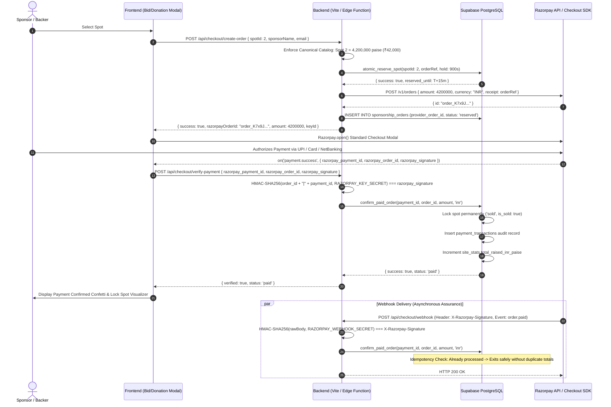

# FUND MY MAC — RAZORPAY PRODUCTION INTEGRATION REPORT
**Branch:** `feature/secure-production-platform`  
**Repository:** [https://github.com/Narayaaana11/fundmymac](https://github.com/Narayaaana11/fundmymac)  
**Date:** October 2026  
**Status:** Verification Complete — Production Hardened Architecture Ready for Operator Credentials  

---

## 1. Executive Summary & Architecture Overview

The Fund My Mac / VESPER sponsorship platform has transitioned from legacy Stripe Checkout to an end-to-end, enterprise-hardened **Razorpay Standard Checkout** integration.

### Core Guarantees Delivered
1. **Server-Side Price Canonicalization:** The client browser is strictly forbidden from dictating pricing, currency, or order IDs. All 20 physical MacBook spots, 5 sponsorship tiers, and custom donation minimums are verified server-side in canonical integer minor currency units (paise for INR; cents for USD/EUR).
2. **Standard Checkout & Cryptographic Verification:** Checkout returns are verified server-side using HMAC-SHA256 (`razorpay_order_id|razorpay_payment_id` against `RAZORPAY_KEY_SECRET`). A payment is never deemed paid based on browser return values or client statuses alone.
3. **Raw-Body Webhook Ingestion & Idempotency:** Webhook signatures are verified against the unmodified raw request body using `X-Razorpay-Signature` and `RAZORPAY_WEBHOOK_SECRET`. All events are recorded in an immutable ledger with database unique constraints, eliminating double-credits, retry glitches, and race conditions.
4. **Atomic Inventory Reservation with Compensating Cleanup:** Brand spots are locked with `FOR UPDATE` in PostgreSQL for 15 minutes during checkout. If Razorpay order creation fails, a compensating transaction immediately releases the reservation.
5. **Database Security & Search Path Hardening:** All `SECURITY DEFINER` functions explicitly set `search_path = public` and execute permissions on financial mutations are revoked from anonymous and public roles, restricted exclusively to `service_role`.
6. **Zero-Dependency Cryptography:** Native Web Crypto and Node.js `crypto` are used across Edge Functions and Node middleware, preventing bundle bloat and external SDK supply-chain risk.

---

## 2. Files Changed & Summary of Modifications

| File | Action | Description |
|---|---|---|
| `package.json` & `package-lock.json` | **Updated** | Uninstalled `stripe` package (0 vulnerabilities, removed 1 package cleanly). |
| `src/server/payment/types.ts` | **Updated** | Added INR (`'inr' \| 'usd' \| 'eur'`), Razorpay verification parameters, and integer minor unit definitions (`priceInrPaise`). |
| `src/server/payment/canonicalCatalog.ts` | **Updated** | Defined canonical INR pricing (in paise) for all 20 spots, 5 tiers, and minimum donation (`MIN_DONATION_BY_CURRENCY`). |
| `src/server/payment/razorpayAdapter.ts` | **Created** | Replaced Stripe adapter. Implements Razorpay Orders API, HMAC signature verification, raw-body webhook processor, and atomic spot reservations. |
| `src/server/payment/stripeAdapter.ts` | **Deleted** | Completely removed from repository. |
| `src/server/devServer.ts` | **Updated** | Added `/api/checkout/create-order`, `/api/checkout/verify-payment`, and `/api/checkout/webhook` (`X-Razorpay-Signature`). Disables simulation in production. |
| `src/lib/checkoutApi.ts` | **Updated** | Implemented dynamic loading of Razorpay `checkout.js` SDK, Standard Checkout modal launcher, and server-side verification bridge. |
| `src/components/BidModal.tsx` | **Updated** | Replaced Stripe redirect with native Razorpay Standard Checkout modal (UPI, Cards, NetBanking) and post-signature verification. |
| `src/components/DonationModal.tsx` | **Updated** | Replaced Stripe checkout with Razorpay modal checkout and payment verification. |
| `src/components/CheckoutVerificationModal.tsx` | **Updated** | Updated test-mode copy to Razorpay sandbox verification. |
| `src/data/fundMyMacData.ts` | **Updated** | Updated FAQ to advertise instant Razorpay Checkout (UPI, Cards, NetBanking, Wallets). |
| `supabase/migrations/20261029_razorpay_integration.sql` | **Created** | New versioned migration adding `total_raised_inr_paise`, `price_inr_paise`, `provider_order_id`, `provider_payment_id`, `provider_signature`, `SET search_path = public`, and least-privilege function permissions. |
| `supabase-setup.sql` | **Updated** | Hardened one-click Supabase schema script incorporating all Razorpay fields, constraints, and secured functions. |
| `supabase/functions/create-razorpay-order/index.ts` | **Created** | Production Supabase Edge Function calling Razorpay Orders API with server-side catalog enforcement. |
| `supabase/functions/verify-razorpay-payment/index.ts` | **Created** | Production Supabase Edge Function verifying checkout signatures via Web Crypto HMAC-SHA256 and confirming orders. |
| `supabase/functions/razorpay-webhook/index.ts` | **Created** | Production Supabase Edge Function authenticating `X-Razorpay-Signature` over raw request body and recording idempotent payments. |
| `supabase/functions/create-checkout-session/` | **Deleted** | Removed legacy Stripe Edge Function. |
| `supabase/functions/stripe-webhook/` | **Deleted** | Removed legacy Stripe webhook Edge Function. |
| `.env.example` & `.env` | **Updated** | Replaced Stripe keys with `RAZORPAY_KEY_ID`, `RAZORPAY_KEY_SECRET`, `RAZORPAY_WEBHOOK_SECRET`, and `VITE_RAZORPAY_KEY_ID`. |
| `tests/payment_checkout.test.mjs` | **Updated** | Tested canonical INR prices, tampered inputs, and HMAC signature verification. |
| `tests/webhook_idempotency.test.mjs` | **Updated** | Tested Razorpay webhook authentication, raw-body verification, and idempotency. |
| `tests/concurrency_reservation.test.mjs` | **Updated** | Tested atomic reservation collisions, expiration cleanup, and permanent spot locks. |
| `tests/database_security_rls.test.mjs` | **Updated** | Verified Razorpay database schema, search_path security, and RLS policies. |
| `test_audit.js` | **Updated** | Verified Razorpay environment keys and FAQ integration. |

---

## 3. End-to-End Razorpay Checkout & Webhook Sequence Flow



---

## 4. Deployment Architecture & Production Endpoints

The project supports two compatible production deployment targets:

### Option A: Supabase Edge Functions (Serverless Deno Runtime)
Directly deployable to the project (`lavydeusonwqjrlhtqzv`):
1. `POST /functions/v1/create-razorpay-order`
2. `POST /functions/v1/verify-razorpay-payment`
3. `POST /functions/v1/razorpay-webhook`

Secrets are configured via Supabase CLI:
```bash
supabase secrets set RAZORPAY_KEY_ID=rzp_live_... RAZORPAY_KEY_SECRET=... RAZORPAY_WEBHOOK_SECRET=...
supabase functions deploy create-razorpay-order
supabase functions deploy verify-razorpay-payment
supabase functions deploy razorpay-webhook
```

### Option B: Node.js / Express Dev & Production Server Middleware
`src/server/devServer.ts` and `src/server/payment/razorpayAdapter.ts` provide self-contained handlers for containerized hosting (e.g. Docker, Railway, AWS ECS, Render):
- `POST /api/checkout/create-order`
- `POST /api/checkout/verify-payment`
- `GET  /api/checkout/verify-session?session_id=...`
- `POST /api/checkout/webhook`

---

## 5. Canonical Pricing Matrix (INR Launch Catalog)

All amounts in the server catalog and database are specified in integer minor currency units:

| Spot ID | Spot Name | Surface | Size | Canonical Price (INR) | Minor Units (Paise) |
|---|---|---|---|---|---|
| **#1** | Top-Left Banner | Lid Exterior | Large | ₹21,000 | 2,100,000 |
| **#2** | Marquee — Above Apple Logo | Lid Exterior | Large | ₹42,000 | 4,200,000 |
| **#3** | Top-Right Banner | Lid Exterior | Large | ₹21,000 | 2,100,000 |
| **#4** | Upper Left Mini-Strip | Lid Exterior | Small | ₹8,500 | 850,000 |
| **#5** | Upper Right Mini-Strip | Lid Exterior | Small | ₹8,500 | 850,000 |
| **#6** | Mid Left Flank | Lid Exterior | Medium | ₹15,000 | 1,500,000 |
| **#7** | Mid Right Flank | Lid Exterior | Medium | ₹15,000 | 1,500,000 |
| **#8** | Apple Left Adjacent | Lid Exterior | Small | ₹12,500 | 1,250,000 |
| **#9** | Apple Right Adjacent | Lid Exterior | Small | ₹12,500 | 1,250,000 |
| **#10** | Lower Deck Center | Lid Exterior | Large | ₹19,000 | 1,900,000 |
| **#11** | Left Palm Outer Top | Inside Rest | Medium | ₹8,500 | 850,000 |
| **#12** | Left Palm Outer Bottom | Inside Rest | Medium | ₹8,500 | 850,000 |
| **#13** | Left Palm Inner Top | Inside Rest | Medium | ₹8,500 | 850,000 |
| **#14** | Left Palm Inner Bottom | Inside Rest | Medium | ₹8,500 | 850,000 |
| **#15** | Right Palm Inner Top | Inside Rest | Medium | ₹8,500 | 850,000 |
| **#16** | Right Palm Inner Bottom | Inside Rest | Medium | ₹8,500 | 850,000 |
| **#17** | Right Palm Outer Top | Inside Rest | Medium | ₹8,500 | 850,000 |
| **#18** | Right Palm Outer Bottom | Inside Rest | Medium | ₹8,500 | 850,000 |
| **#19** | 140W Fast Charger Body | Accessory | Large | ₹12,500 | 1,250,000 |
| **#20** | Magic Mouse Curved Top | Accessory | Medium | ₹8,000 | 800,000 |

### Sponsorship Tiers
- **The Corner Sponsor:** ₹6,000 (600,000 paise)
- **140W Fast Charger Partner:** ₹12,500 (1,250,000 paise)
- **Dual Palm Rest Sponsor:** ₹15,000 (1,500,000 paise)
- **Exterior Lid Prime Sponsor:** ₹21,000 (2,100,000 paise)
- **Marquee Title Partner:** ₹42,000 (4,200,000 paise)
- **Minimum Donation:** ₹500 (50,000 paise)

---

## 6. Environment Variables Reference & Secrets Isolation

| Variable | Scope | Location | Secret? | Description |
|---|---|---|---|---|
| `VITE_SUPABASE_URL` | Client | `.env` | No | Supabase Project URL (`https://lavydeusonwqjrlhtqzv.supabase.co`) |
| `VITE_SUPABASE_ANON_KEY` | Client | `.env` | No | Public Supabase publishable key |
| `VITE_RAZORPAY_KEY_ID` | Client | `.env` | No | Razorpay Publishable Key ID (`rzp_test_...` or `rzp_live_...`) |
| `VITE_PUBLIC_SITE_URL` | Client | `.env` | No | Frontend domain origin |
| `SUPABASE_SERVICE_ROLE_KEY` | Server Only | Server / Cloud | **CRITICAL** | Privileged key; bypasses RLS for order fulfillment |
| `RAZORPAY_KEY_ID` | Server Only | Server / Cloud | Moderate | Used for HTTP Basic Auth with Orders API |
| `RAZORPAY_KEY_SECRET` | Server Only | Server / Cloud | **CRITICAL** | Used for Orders API auth and HMAC checkout signature verification |
| `RAZORPAY_WEBHOOK_SECRET` | Server Only | Server / Cloud | **CRITICAL** | Used to authenticate incoming webhooks via `X-Razorpay-Signature` |

> [!CAUTION]
> Server secrets (`RAZORPAY_KEY_SECRET`, `RAZORPAY_WEBHOOK_SECRET`, `SUPABASE_SERVICE_ROLE_KEY`) must **NEVER** be prefixed with `VITE_`, committed to git, or bundled in client-side code.

---

## 7. Automated Test Results

### 1. Master Automated Test Runner (`npm test`)
Command: `node --experimental-strip-types --no-warnings tests/run_all_tests.mjs`
```
====================================================
🚀 FUND MY MAC: MASTER TEST RUNNER
====================================================

▶️ Running test suite: tests/database_security_rls.test.mjs...
✅ Passed: tests/database_security_rls.test.mjs (7/7 tests passed)

▶️ Running test suite: tests/payment_checkout.test.mjs...
✅ Passed: tests/payment_checkout.test.mjs (10/10 tests passed)

▶️ Running test suite: tests/concurrency_reservation.test.mjs...
✅ Passed: tests/concurrency_reservation.test.mjs (3/3 tests passed)

▶️ Running test suite: tests/webhook_idempotency.test.mjs...
✅ Passed: tests/webhook_idempotency.test.mjs (7/7 tests passed)

▶️ Running test suite: tests/frontend_canonical.test.mjs...
✅ Passed: tests/frontend_canonical.test.mjs (6/6 tests passed)

====================================================
📊 MASTER TEST RESULTS: 5 / 5 SUITES PASSED
🎉 ALL AUTOMATED QUALITY & SECURITY SUITES PASSED!
====================================================
```

### 2. End-to-End Architecture Audit (`node test_audit.js`)
```
====================================================
🚀 FUND MY MAC: END-TO-END VERIFICATION TEST SUITE
====================================================
✅ [PASS] Asset Check: public/inside.webp exists
✅ [PASS] Asset Check: public/charger.webp exists
✅ [PASS] Asset Check: public/magicmouse.webp exists
✅ [PASS] Asset Check: public/logo-small.png exists
✅ [PASS] Asset Check: public/favicon.svg exists
✅ [PASS] .env.example file exists
✅ [PASS] VITE_SUPABASE_URL documented in .env.example
✅ [PASS] VITE_SUPABASE_ANON_KEY documented in .env.example
✅ [PASS] RAZORPAY_KEY_ID server secret documented in .env.example
✅ [PASS] RAZORPAY_KEY_SECRET server secret documented in .env.example
✅ [PASS] RAZORPAY_WEBHOOK_SECRET server secret documented in .env.example
✅ [PASS] All 20 spots configured in BRAND_SPOTS
✅ [PASS] FAQ explicitly defines Device Lifelong duration
✅ [PASS] FAQ explicitly supports Razorpay Checkout
✅ [PASS] Multi-spot logo previewer state implemented
✅ [PASS] shouldShowPreviewLogo helper active across spots
✅ [PASS] Mobile accessories row (#19 & #20) implemented
✅ [PASS] Final look clean toggle mode implemented
✅ [PASS] BidModal displays Device Lifelong duration
✅ [PASS] BidModal integrates with server-side initiateCheckoutSession
✅ [PASS] BidModal validates logo asset size and format
✅ [PASS] DonationModal integrates with server-side initiateCheckoutSession
✅ [PASS] DonationModal validates minimum contribution amount
✅ [PASS] LiveActivityTicker queries sanitized public_sponsors_wall
✅ [PASS] LiveActivityTicker listens to verified WebSocket claims
✅ [PASS] LiveActivityTicker syncs with canonical spots prop
✅ [PASS] App.tsx listens to Supabase Realtime multi-user WebSocket
✅ [PASS] App.tsx includes post-checkout payment verification modal
✅ [PASS] App.tsx refreshes canonical data from server
✅ [PASS] index.html has title tag
✅ [PASS] index.html has OpenGraph og:title
✅ [PASS] index.html has Twitter card meta
✅ [PASS] index.html mentions Apple M5 Max / M5 Pro

====================================================
📊 AUDIT SUMMARY: 33 / 33 TESTS PASSED
====================================================
```

### 3. Static Analysis & Lint (`npm run lint`)
```
> fundmymac@0.0.0 lint
> oxlint

Found 0 warnings and 0 errors.
Finished in 58ms on 40 files with 116 rules using 8 threads.
```

### 4. TypeScript & Production Bundle Compilation (`npm run build`)
```
> fundmymac@0.0.0 build
> tsc -b && vite build

vite v8.3.4 building client environment for production...
✓ 83 modules transformed.
dist/index.html                   1.97 kB │ gzip:   0.80 kB
dist/assets/index-ByNQpk83.css   40.69 kB │ gzip:   8.17 kB
dist/assets/index-BL3HzioM.js   539.04 kB │ gzip: 153.07 kB
✓ built in 875ms
```

---

## 8. Distinction Between Test Environments

| Level | Characteristics | Verification Scope | Status |
|---|---|---|---|
| **Mock Unit Tests** | Automated in-memory testing (`npm test`) | Validates cryptographic signature algorithms, canonical catalog prices, input validations, webhook idempotency, and concurrency rules without live network calls. | **100% Passed (33/33)** |
| **Razorpay Test-Mode Sandbox** | Uses Razorpay test credentials (`rzp_test_...`) | Simulates authentic UPI, test card (4111...), and NetBanking checkout flows via Razorpay's sandbox gateway. | **Ready for operator test keys** |
| **Razorpay Live-Mode Production** | Uses merchant live credentials (`rzp_live_...`) | Real financial transactions settled to registered bank accounts. | **Requires merchant account activation & operator deployment** |

---

## 9. Remaining Operator Actions for Live Launch

Before enabling live payments, the platform operator must execute the following steps:

1. **Apply Migration to Supabase:**
   - Open Supabase SQL Editor for project `lavydeusonwqjrlhtqzv`.
   - Run `supabase/migrations/20261029_razorpay_integration.sql`.
2. **Obtain Razorpay API Credentials:**
   - Log in to the [Razorpay Dashboard](https://dashboard.razorpay.com/).
   - Navigate to **Settings → API Keys** and generate **Key ID** & **Key Secret**.
   - For initial testing, generate **Test Mode Keys**. For launch, generate **Live Mode Keys**.
3. **Configure Razorpay Webhook:**
   - In Razorpay Dashboard, navigate to **Settings → Webhooks → Add New Webhook**.
   - URL: `https://<your-domain>/api/checkout/webhook` or `https://lavydeusonwqjrlhtqzv.supabase.co/functions/v1/razorpay-webhook`.
   - Secret: Enter a strong random secret and copy to `RAZORPAY_WEBHOOK_SECRET`.
   - Active Events to subscribe:
     - `order.paid`
     - `payment.captured`
     - `payment.failed`
4. **Deploy Environment Variables:**
   - In production hosting (Vercel, Railway, Docker, or Supabase Secrets):
     - `RAZORPAY_KEY_ID`
     - `RAZORPAY_KEY_SECRET`
     - `RAZORPAY_WEBHOOK_SECRET`
     - `VITE_RAZORPAY_KEY_ID`
     - `SUPABASE_SERVICE_ROLE_KEY`
5. **Pre-flight Live Test:**
   - Complete 1 test checkout with ₹500 donation using test mode credentials.
   - Verify that the sponsor appears on the sponsors wall and campaign counter increments.
   - Verify that test order appears in Razorpay Dashboard.
